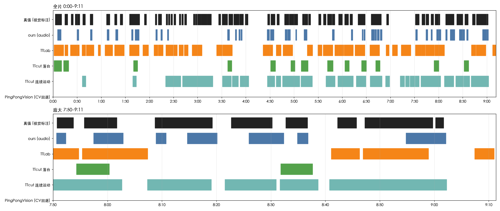

# IMG_6921 回合切分对比：ours / TTLab / TTcut / PingPongVision

视频：`~/Downloads/IMG_6921.mov`，9:11，1920×1080，59.94fps，固定机位（侧后方，近端选手在左、远端在右）。
内容是混合的：0:00–2:07 对打，2:07–3:15 发球-接发练习，3:15–6:15 教练喂球，6:15–9:11 对打（其中 7:13–7:28 是单人练发球）。

## 第二轮：按“你的得分球”评（2026-10-11，用户确认后）

用户是远端学员（深蓝球衣），教练在近端。用户真正关心的是**自己的得分球**，不是全部回合。

- **怎么判输赢**：只看两段对打（25 分）。每分剪出“结束前 3 秒到结束后 1.5 秒”的帧序列（`point_sheets/`），由子代理判输赢（`point_labels_{A,B}.json`），再由用户看确认视频改判（`point_labels_user.json`：P10、P24 是练习不算）。最终你得 15 分、教练 5 分，3 分看不清不计。
- **怎么算剪到**：片段盖住这一分结束前 0.5 秒，即决定胜负的那一板。
- 脚本：`score_points.py`；结果：`points_metrics.json`。

| 工具 | 你的得分球 | 教练得分也被剪入 | 对打段片段 | 含你得分的片段 | 对打段保留 | 每个得分球摊到 |
|---|---|---|---|---|---|---|
| ours | 8/15 | 1/5 | 22 | 36% | 70s | **8.8s** |
| TTLab | **10/15** | 4/5 | 23 | 35% | 186s | 18.6s |
| TTcut 落台 | 4/15 | **0/5** | 7 | **57%** | **44s** | 10.9s |
| TTcut 连续运动 | 8/15 | 4/5 | 14 | 43% | 135s | 16.9s |

- **TTcut 落台最“纯”**：和用户体感一致，但用户的 15 个得分球只剪到 4 个。
- **TTLab 剪到最多，但不挑**：教练得分也剪进了 4/5。
- **ours 最省时间**：教练得分只混进 1 个。5 个教练得分里 4 个是学员失误结束的短分，多半凑不够 2 拍被过滤掉了。
- **ours 和 TTLab 正好互补**：两者合起来 15 个全中。TTLab 抓到前半段对打的全部 7 个，ours 抓到后半段 8 个中的 6 个。

**TTcut 的“落台”为什么偏向学员**（`ttcut_bounce_review.json`、`ttcut_far_end_events.jpg`）：57 次“落台”里，26 次其实是学员的击球瞬间，18 次是学员的球落在教练半台，11 次在网口附近或空中，2 次是教练击球。约 77% 和学员的球有关。学员在远端，击球点在画面里压在球台远端那条带上，被当成落台；教练的击球点在画面里落在球台区域外，几乎不计入。所以它在这个机位下实际是在追学员的出手。这些判断按画面网线分边，再对网后 39 个逐张目测；TTcut 自带的球台坐标因为标定错误，没有使用。

**样本很小**（15 个得分球、5 个失分），以上只能说明趋势。

## 第一轮：按全部回合评

### 一句话结论

- **对打段**：没有一个工具能稳定胜出。前半段 TTLab 最好，后半段 TTcut 连续运动最好，但这两个工具在另一半都有明显失误。
- **ours**：精度一直最高、死球最少、速度快 100 倍，但短分会漏。
- **TTcut 的默认落台模式**在这个机位下基本不可用。
- **PingPongVision** 没拿到模型权重，这次没有有效结果。

## 全片结果

| 工具 | 片段数 | 保留时长 | 回合召回 | 片段精度 | 回合时间覆盖 | 片段里的死球时间 | 一段里混了≥2分 | 耗时 (M2 Pro) |
|---|---|---|---|---|---|---|---|---|
| **ours**（highlight.py 的音频回合） | 37 | 105s (19%) | 54% | **100%** | 34% | **14s** | 6 | **6s** |
| **TTLab** | 40 | 326s (59%) | **85%** | 88% | 73% | 131s | 12 | 35s |
| **TTcut 落台判定**（App 默认） | 13 | 81s (15%) | 25% | 100% | 25% | 15s | 2 | 834s (CPU) |
| **TTcut 连续运动** | 27 | 302s (55%) | 77% | 89% | **77%** | 98s | 12 | 565s (CPU) |
| **PingPongVision**（纯 CV 回退） | 0 | 0 | 0 | – | 0 | 0 | 0 | 239s |

真值：61 个回合，共 266.5s（占全片 48%）。ours 的耗时取自 `highlight.py` 那次运行，`compare.py` 里写死为 6s。

## 分段结果（召回 / 时间覆盖 / 死球秒数）

全片数字受 2:07–6:15 的训练段影响很大：这 4 分钟几乎都是连续的发球、喂球。做比赛高光，应该主要看两段对打。

| 工具 | 对打 0:00–2:07（11 分） | 发球-接发练习（14） | 教练喂球（22） | 对打 6:15–9:11（14 分） |
|---|---|---|---|---|
| ours | 55% / 40% / **1s** | 29% / 7% / 3s | 55% / 28% / 4s | 79% / 50% / **6s** |
| TTLab | **100% / 98%** / 35s | 93% / 72% / 16s | 82% / 64% / 37s | 71% / 68% / 44s |
| TTcut 落台 | 27% / 32% / 4s | 0 / 0 / 0 | 36% / 34% / 6s | 29% / 22% / 5s |
| TTcut 连续运动 | **18% / 15%** / 1s | 86% / 78% / 21s | **86% / 87%** / 36s | **100% / 100%** / 42s |

- **TTcut 连续运动**在后半段对打和训练段都很好，但**前半段对打几乎全漏**（召回 18%）。所以它全片排第二，原因是这两段一好一坏抵消了。
- **TTLab**在前半段对打召回 100%，但保留下来的 85s 里有 35s 是死球。后半段对打它漏掉了 8:07–8:41，正好是全片最密集的一段。
- **ours**在两段对打里的死球都只有 1–6s。漏掉的 8 个对打回合全部是 2.5–4s 的短分，回合里只检测到 1 次击球（发球或接发声音太轻，或者两拍间隔超过 1.5s），达不到"≥2 拍"的门槛。训练段召回低也是同一个原因：发球加一板接发，通常只能听到一声。

## 高光选择

| 工具 | 它认为最好的 | 真值核对 |
|---|---|---|
| ours | 60s 窗口 7:39.5–8:39.5 | 窗口内 38s 在打球，6 个完整回合，最长 10.5s。全片 60s 窗口里排前 7.5%。真值最密的窗口在 2:57（教练喂球段），不算比赛高光 |
| TTLab | 17 个 `is_highlight` 回合，分最高的是 0:56.5 | **0:56.5–0:59.2 是死球**：两人拿着球筐走动（见 `spot_check.jpg` 第一行）。它按分数取的前 5 个，没有一个是真值里最长的 5 个回合 |
| TTcut | 落台模式按落台次数，连续运动模式按时长 | 落台模式的前 5 个没有命中真值最长的 5 个；连续运动模式命中 1 个 |

## 各工具的观察

**ours（音频）**
- 切出来的都是真回合（精度 100%），漏的是短分（见上）。
- 死球后，球在地上或台上的弹跳声也会被当成击球。例如 8:30.25–8:31.9 报了 5 次"击球"，画面里是在捡球（`spot_check2.jpg`）。后果是回合尾巴拖长，相邻两分被并成一个（6 段）。
- 片段边界是"第一拍到最后一拍"，没有包含抛球，所以时间覆盖只有 34%。

**TTLab**（运动检测 + 音频峰值，`frame_step=2`，宽度 960）
- 召回高，代价是保留了 59% 的时长，其中 131s 是死球。
- 单个回合硬上限 12s（`max_rally_duration`）。13 段被截在 12s，长回合会被切短，相邻几分也会混在一起。
- 5 个误检片段里，7:13–7:25 落在单人练发球段，球确实在飞，只是按定义不算回合；7:02–7:09 是两人来回传球。另外 3 个（0:56、5:50、9:07）是真正的死球。
- 它的高光分值和真实精彩程度基本不相关：分最高的那段是死球。
- 不传球台坐标时（它的前端要手点），球验证步骤不会生效（`ball_hits` 全为 0）。

**TTcut**（BlurBall 球检测 + SegFormer 自动球台标定，worker 直接调用，GUI 未跑）
- **自动标定有误**（更正）：`bottom_left` 落在近端底线的中点（中线起点），真正的左下角在 x≈397；而且它把远端底线（top_left→top_right）当成了长边，长宽方向弄反。之前写的“四个角准确”是在缩小截图上的误判。
- **落台判定（App 默认）在这个机位下几乎不可用**：全片只检测到 57 次落台，凑成 13 个回合（要求 ≥2 次落台、间隔 ≤3s）。这个机位从侧后方拍，远半台被严重压缩，可能是原因，但我没有验证。
- **连续运动模式**的 3 个误检片段（7:12–7:30）全部是单人练发球，球确实在飞，不算真正的错误。它的问题是开头 0:00–2:20 几乎全漏。那段画面里球台右侧多了一个白色球筐（`view_check.jpg` 的 5s、30s），这只是猜测，原因没查实。
- macOS 上只能用 CPU（worker 只支持 `cpu`/`cuda`），9 分钟的视频要跑 9–14 分钟。

**PingPongVision**
- 它需要 TrackNetV3_TableTennis 的权重，但上游（wasn-lab/TrackNetV3_TableTennis）和 PingPongVision 文档里给的 OneDrive 链接都已失效（"cannot access this document"），所以没跑成正式版本。
- 纯 CV 回退在全片得到 0 个回合。作者说明过这个回退只供开发用，不代表它的真实水平，**不能作为它的正式成绩**。
- 球台用的是 TTcut 自动标定得到的四个角（后来发现这组角点有误，见上）：`[[861.1,705.8],[1264.3,715.5],[1009.9,855.3],[688.3,840.8]]`。

## 对我们项目的启示

1. **音频和视觉各有短板，正好互补。** 音频精度高、几乎不带死球、速度快（6s），但漏短分，还会把死球弹跳当成击球。视觉方法（TTLab、TTcut 连续运动）召回高，但在不同时段时好时坏，会混入 35–44s 的死球，而且 TTcut 很慢。可行的组合是：先用"球在飞"的视觉信号定回合起止，再用击球声去掉没有击球的片段、数拍数。
2. **单拍短分不要直接丢。** 把"≥2 拍"放宽为"1 拍 + 视觉确认有球飞行"，可以补回漏掉的 8 个对打短分。
3. **加一道过滤，去掉死球后的弹跳。** 落点在球台以外的"击球"、或间隔明显不符合来回节奏的"击球"，应该剔除。这样能直接修复拖尾和合并问题。有了球台标定（TTcut 的标定模型效果不错），可以用位置判断。
4. **回合起点应该往前推到抛球。** 目前从第一拍开始切，发球被切掉了。
5. **长回合≠高光。** TTLab 的打分和 TTcut 的落台计数都选不出好片段。我们按"拍数^1.5 的窗口"选出的片段排前 7.5%，相对最好，但还不能识别"打得好"。

## 方法与局限

- **真值不是人工逐帧标注**：由 3 个子代理按每 0.5s 一帧的缩略图（`gt_sheets/`）纯视觉标注 R/D/U，标注时看不到任何工具的输出。我抽查了 4 处（0:56–0:59、8:11–8:13、8:25–8:27、8:29–8:33），都和画面一致。边界精度约 ±0.5s，三段之间没有重叠标注，所以没有一致性数据。U（单人练发球、看不清）一律不算回合。
- **"回合"包含训练性质的来回**：教练喂球、发球-接发练习都算回合。比赛对打的结论看分段表。
- **只有一个视频、一个机位**，结论不能直接推广。
- 运行方式：TTLab 和 TTcut 都是无界面直接调用核心检测代码，没有走它们的 Web/GUI。参数取各自的默认值：TTLab 用"background"模式，TTcut 用 `full` 模式、阈值 0.7、导出前 2.5s 后 1s。
- 许可证：TTcut 是 GPL-3.0；TTLab 只允许个人非商业使用；PingPongVision 没有许可证。这次只做本地评测，没有把它们的代码拷进本项目。

## 文件

- `compare.py`：重算指标和画图：`python3 benchmarks/IMG_6921/compare.py`（需要 numpy、matplotlib）
- `metrics.json`：全部指标（含分段 `by_section`）和真值区间
- `gt_labels_{A,B,C}.json`：逐帧标注；`gt_sheets/`：标注用的缩略图
- `*_full.json` / `*.log`：各工具的原始输出和日志
- `ours_hits.json`：我们检测到的击球时刻
- `calib_check.jpg`、`view_check.jpg`、`spot_check*.jpg`：上文引用的截图
